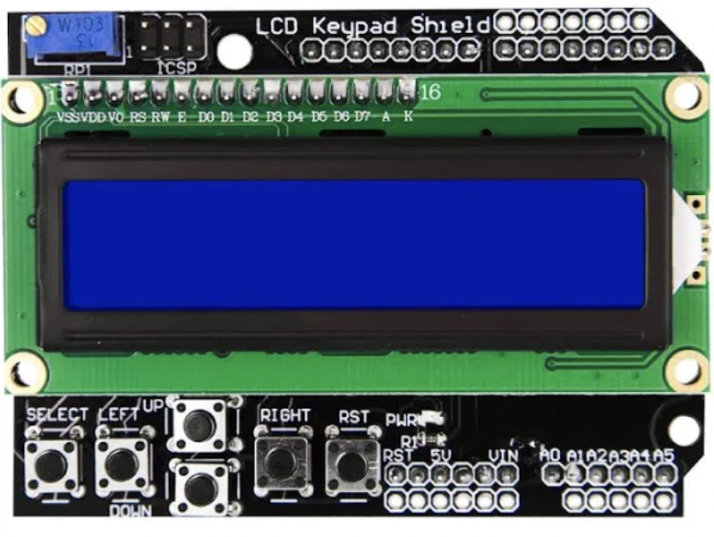
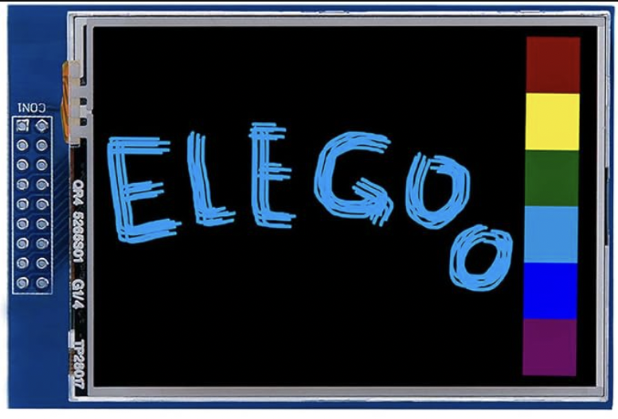
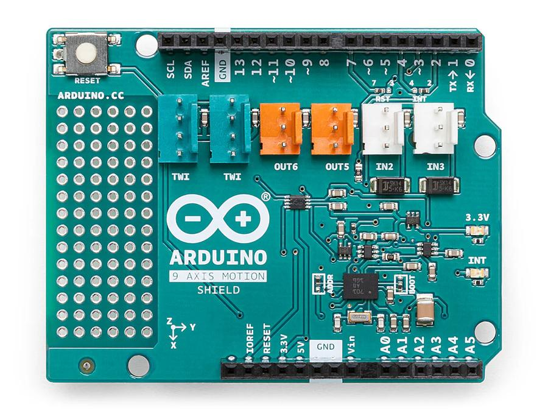
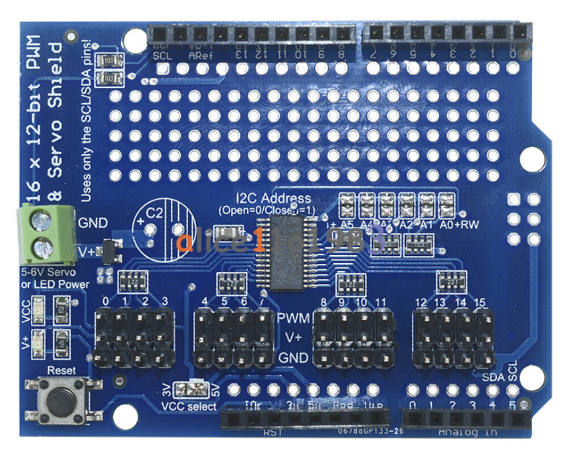
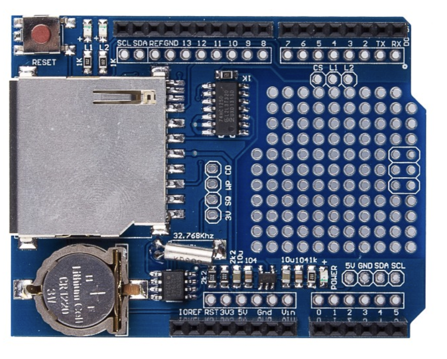
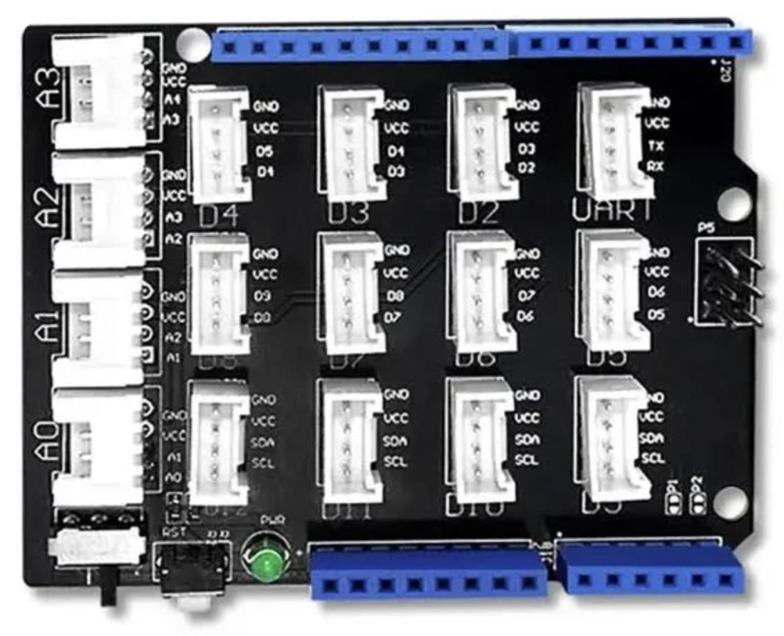

# JUno: Java for Arduino One

JUno `/ˈxu.no/` is an ahead-of-time compiler for running a practical subset of Java on Arduino boards. It keeps `javac` as the Java frontend, performs
closed-world linking on the development machine, and emits GNU ARM (Cortex-M4, Thumb-2) assembly,
AVR assembly for the UNO R3's ATmega328P and the UNO WiFi Rev2's ATmega4809, or Xtensa assembly for the
Nano ESP32's ESP32-S3 (GPIO, delays and serial so far).

[](https://github.com/jabrena/juno/actions/workflows/maven.yaml)

## Arduino boards

<table>
  <tr>
    <td align="center" width="50%">
      <strong>Arduino One Q</strong><br>
      
    </td>
    <td align="center" width="50%">
      <strong>Arduino One R4 WiFi</strong><br>
      
    </td>
  </tr>
  <tr>
    <td align="center" width="50%">
      <strong>Arduino One WiFi Rev2</strong><br>
      
    </td>
    <td align="center" width="50%">
      <strong>Arduino One R3</strong><br>
      
    </td>
  </tr>
</table>

## Arduino Shields

<table>
  <thead>
    <tr>
      <th>Shield</th>
      <th>Image</th>
      <th>Supported features</th>
    </tr>
  </thead>
  <tbody>
  <tr>
    <td><strong>LCD Keypad Shield</strong></td>
    <td align="center"></td>
    <td>16x2 HD44780 character display, five-button keypad, and controllable backlight.</td>
  </tr>
  <tr>
    <td><strong>ELEGOO 2.8-inch TFT Touch Shield</strong></td>
    <td align="center"></td>
    <td>240x320 ILI9341 display, resistive touch input, and an onboard microSD socket.</td>
  </tr>
  <tr>
    <td><strong>Arduino 9 Axis Motion Shield</strong></td>
    <td align="center"></td>
    <td>BNO055 heading, pitch, roll, gyroscope, and calibration data over I2C.</td>
  </tr>
  <tr>
    <td><strong>PCA9685 PWM &amp; Servo Shield</strong></td>
    <td align="center"></td>
    <td>Sixteen independently controlled 12-bit PWM/servo channels over I2C.</td>
  </tr>
  <tr>
    <td><strong>AZDelivery Data Logger Shield</strong></td>
    <td align="center"></td>
    <td>SPI SD-card access. The shield's real-time clock is not currently exposed.</td>
  </tr>
  <tr>
    <td><strong>Grove Base Shield</strong></td>
    <td align="center"></td>
    <td>Grove digital, analog, I2C, and UART connectors.</td>
  </tr>
  </tbody>
</table>

## Quick start

Requirements: JDK 27+ and Maven 3.10+.

```bash
./mvnw clean install
```

### Local SonarQube Community

Start the local SonarQube Community instance with Docker Compose:

```bash
docker compose -f docker-compose.sonar.yml up -d
```

The one-shot `sonar-init` service creates a local analysis user and writes its credentials and token to the ignored
`.sonar/sonar.env` file. Wait for that file, load it, and run the Maven analysis from the repository root:

```bash
until test -s .sonar/sonar.env; do sleep 2; done
set -a
. .sonar/sonar.env
set +a
./mvnw -Pjacoco,sonar clean verify sonar:sonar
```

The defaults use the local `admin`/`admin` bootstrap credentials and create `juno-sonar` with password
`juno-sonar-local`. Override `SONAR_ADMIN_PASSWORD`, `SONAR_ANALYSIS_LOGIN`, `SONAR_ANALYSIS_PASSWORD`, or
`SONAR_TOKEN_NAME` in `.env` before starting Compose if needed. The `sonar` profile is opt-in, and the `jacoco` profile
supplies the XML coverage reports used by SonarQube. Stop the instance when it is no longer needed:

```bash
docker compose -f docker-compose.sonar.yml down
```

### Blink

[`Blink`](juno-examples/src/main/java/io/github/jabrena/juno/api/hardware/gpio/Blink.java) runs unmodified on every
supported board. Its built-in LED alternates on and off every 500 ms (one full cycle per second).

```java
package io.github.jabrena.juno.api.hardware.gpio;

import io.github.jabrena.juno.hardware.MCU;
import io.github.jabrena.juno.hardware.gpio.DigitalOutput;
import io.github.jabrena.juno.util.Delay;

public final class Blink {

    public static void main(String[] args) {

        DigitalOutput led = DigitalOutput.of(MCU.getGpio().getBuiltinLed());

        while (true) {
            led.high();
            Delay.millis(500);

            led.low();
            Delay.millis(500);
        }
    }
}
```

The project provides a `Maven plugin` to help the user with the common operations. `juno:upload` generates the sketch, verifies it with `arduino-cli`, and flashes it in one step.
`Blink` has no board restriction, so pick a target with `-Djuno.board`:

```bash
./mvnw -f juno-examples/pom.xml compile juno:upload \
  -Djuno.main=io.github.jabrena.juno.api.hardware.gpio.Blink \
  -Djuno.board=arduino-uno-q
  #-Djuno.board=arduino-uno-r4-wifi
  #-Djuno.board=arduino-uno-r3-wifi-rev2
  #-Djuno.board=arduino-uno-r3
  #-Djuno.board=arduino-nano-esp32
```

It auto-detects the port when exactly one matching board is connected. Otherwise, select it with
`-Djuno.port=<PORT>`. Select another example with `-Djuno.main=<fully-qualified-class-name>`.

## Maven plugin

The `juno` Maven plugin provides these goals. The commands below run them from the examples module;
add `-Djuno.main=<fully-qualified-class-name>` and `-Djuno.board=<id>` when the entry point has no single-board
`@Board` declaration.

<table>
  <thead>
    <tr>
      <th>Goal</th>
      <th>Purpose</th>
      <th>Command</th>
    </tr>
  </thead>
  <tbody>
    <tr>
      <td><code>juno:boards</code></td>
      <td>Lists the boards and serial ports detected by Arduino CLI without touching a board.</td>
      <td><code>./mvnw -f juno-examples/pom.xml juno:boards</code></td>
    </tr>
    <tr>
      <td><code>juno:install-deps</code></td>
      <td>Installs the Arduino core and optional libraries required by the examples.</td>
      <td><code>./mvnw -f juno-examples/pom.xml juno:install-deps</code></td>
    </tr>
    <tr>
      <td><code>juno:compile</code></td>
      <td>Generates the assembly, C++ runtime shim, and Arduino sketch wrapper.</td>
      <td><code>./mvnw -f juno-examples/pom.xml compile juno:compile -Djuno.main=io.github.jabrena.juno.api.hardware.gpio.Blink -Djuno.board=arduino-uno-r4-wifi</code></td>
    </tr>
    <tr>
      <td><code>juno:verify</code></td>
      <td>Generates the sketch and compiles it with Arduino CLI without using physical hardware.</td>
      <td><code>./mvnw -f juno-examples/pom.xml compile juno:verify -Djuno.main=io.github.jabrena.juno.api.hardware.gpio.Blink -Djuno.board=arduino-uno-r4-wifi</code></td>
    </tr>
    <tr>
      <td><code>juno:upload</code></td>
      <td>Generates, verifies, and uploads the sketch to the selected or detected board.</td>
      <td><code>./mvnw -f juno-examples/pom.xml compile juno:upload -Djuno.main=io.github.jabrena.juno.api.hardware.gpio.Blink -Djuno.board=arduino-uno-r4-wifi</code></td>
    </tr>
    <tr>
      <td><code>juno:monitor</code></td>
      <td>Opens the serial monitor for the selected or detected board.</td>
      <td><code>./mvnw -f juno-examples/pom.xml juno:monitor -Djuno.board=arduino-uno-r4-wifi</code></td>
    </tr>
  </tbody>
</table>

For example, verify the Grove Temperature and Humidity Sensor Pro monitor for an UNO WiFi Rev2
without uploading it:

```bash
./mvnw -f juno-examples/pom.xml compile juno:verify \
  -Djuno.main=io.github.jabrena.juno.api.thirdparty.grove.sensors.GroveDht22Monitor \
  -Djuno.board=arduino-uno-r3-wifi-rev2
```

## Supported Java subset

Juno is an ahead-of-time compiler, not a JVM, so it intentionally supports a focused, predictable
subset of Java that can be translated into native code for resource-constrained Arduino boards.
Programs are first compiled normally with `javac`; Juno then performs closed-world linking from
`main`, follows every reachable method, and validates the bytecode before generating the sketch.

Valid Java is therefore not automatically valid Juno input. If reachable code needs an unsupported
bytecode instruction, JDK feature, or `invokedynamic` bootstrap, compilation stops instead of
emitting code with uncertain behavior. The diagnostic identifies the method, bytecode offset, and
unsupported operation or bootstrap. The currently supported Java subset includes:

- **Entrypoints and methods:** `static void main(String[])`, the embedded-friendly
  `static void main()`, static methods with primitive arguments and results, direct closed-world
  calls, and removal of unreachable methods. See
  [`HelloWorld`](juno-examples/src/main/java/io/github/jabrena/juno/language/HelloWorld.java) and
  [`Methods`](juno-examples/src/main/java/io/github/jabrena/juno/language/Methods.java).
- **Primitive types:** `boolean`, `byte`, `short`, `char`, `int`, `long`, `float`, and `double`.
  The example prints each type's size and range using `javac`-folded `BYTES`, `MIN_VALUE`, and
  `MAX_VALUE` constants. See
  [`PrimitiveTypes`](juno-examples/src/main/java/io/github/jabrena/juno/language/PrimitiveTypes.java).
- **Values and control flow:** constants, mutable static fields, local variables, arithmetic,
  bitwise and shift operations, comparisons, conditionals, `switch`, and loops. See
  [`Variables`](juno-examples/src/main/java/io/github/jabrena/juno/language/Variables.java),
  [`Operators`](juno-examples/src/main/java/io/github/jabrena/juno/language/Operators.java), and
  [`ControlFlow`](juno-examples/src/main/java/io/github/jabrena/juno/language/ControlFlow.java).
- **Arrays:** fixed-size primitive arrays (`boolean` through `double`, including fixed-size
  multidimensional arrays) allocated from the fixed 8 KiB arena, and `static final` read-only lookup
  tables with an all-constant initializer, kept in flash instead of RAM. See
  [`Arrays`](juno-examples/src/main/java/io/github/jabrena/juno/language/Arrays.java).
- **Strings:** string literals, `String.valueOf(int)`, `length()`, and `charAt(int)` for runtime
  string references, `equals`, plus `+` concatenation of strings and a `StringBuilder`. See
  [`Strings`](juno-examples/src/main/java/io/github/jabrena/juno/language/Strings.java).
- **BigInteger and BigDecimal:** arbitrary-precision `java.math.BigInteger` and `BigDecimal`, with
  `MathContext` and the `RoundingMode` constants. Arithmetic, `pow`, `sqrt`, division by scale,
  `RoundingMode` or `MathContext`, `setScale`, `round`, comparisons, conversions and `toString` /
  `toPlainString` follow the JDK's results, scales and rounding. Values are immutable blocks in the
  8 KiB arena and are garbage-collected, so precision is limited by memory, not by a fixed width. See
  [`ScopedValuesPrecision`](juno-examples/src/main/java/io/github/jabrena/juno/language/ScopedValuesPrecision.java).
- **LocalDateTime:** a bounded `java.time.LocalDateTime` subset with `now()`, `MIN`, calendar and clock
  component accessors, `equals`, and ISO-8601 `toString`. `now()` synchronizes UTC over HTTPS after Wi-Fi
  connects; configure the endpoint and JSON path with `InternetClock.configure(Properties)` or the
  `JUNO_LOCAL_DATE_TIME_URL` / `JUNO_LOCAL_DATE_TIME_JSON_PATH` build settings. If the clock is unavailable,
  `now()` returns `LocalDateTime.MIN`. Values are immutable one-word handles in the arena. Supported on the
  UNO R4 WiFi, UNO Q, and UNO R3 WiFi Rev2; classic UNO R3 is rejected because it has no HTTPS runtime. See
  [`InternetTime`](juno-examples/src/main/java/io/github/jabrena/juno/api/hardware/net/time/InternetTime.java). Its SD-card
  `application.properties` requires `wifi.ssid` and `wifi.password`; optionally set `time.api.url` and
  `time.api.jsonPath` to select a different HTTPS endpoint and JSON field, for example:
  `wifi.ssid=YOUR_WIFI_SSID`, `wifi.password=YOUR_WIFI_PASSWORD`,
  `time.api.url=https://gateway.timeapi.world/timezone/Etc/UTC`, and `time.api.jsonPath=utc_datetime`.
- **UUID:** immutable `java.util.UUID` values with construction, bit access, version/variant,
  equality, ordering, canonical parsing/formatting, and caller-buffer 16-byte network conversion
  through `UuidCodec`. `UUID.randomUUID()` uses the RA4M1 SCE5 TRNG on UNO R4 WiFi, the
  ATECC608 secure element on UNO WiFi Rev2, and the STM32U585 Zephyr CSPRNG on UNO Q; it is
  rejected on classic UNO R3. `PortNoise.collectSeed` is an explicitly non-cryptographic,
  opt-in collector for a user-provided physical noise circuit.
- **Objects:** simple enums, records, final closed-world classes, constructors, and instance fields.
  Objects, records, and capturing closures share the fixed 8 KiB arena, which uses conservative
  garbage collection. See
  [`Objects`](juno-examples/src/main/java/io/github/jabrena/juno/language/Objects.java).
- **Interfaces:** directly implemented interfaces with closed-world dispatch through an interface
  reference. See
  [`Interfaces`](juno-examples/src/main/java/io/github/jabrena/juno/language/Interfaces.java).
- **Lambdas and method references:** non-capturing and capturing lambdas, plus static, bound,
  unbound, and constructor references emitted through `LambdaMetafactory.metafactory`. See
  [`Lambdas`](juno-examples/src/main/java/io/github/jabrena/juno/language/Lambdas.java).
- **Math and random numbers:** the documented `java.lang.Math` subset and Arduino-backed bounded
  pseudorandom numbers. See
  [`MathFunctionsSinglePrecision`](juno-examples/src/main/java/io/github/jabrena/juno/language/MathFunctionsSinglePrecision.java),
  [`MathFunctionsDoublePrecision`](juno-examples/src/main/java/io/github/jabrena/juno/language/MathFunctionsDoublePrecision.java) and
  [`RandomNumbers`](juno-examples/src/main/java/io/github/jabrena/juno/language/RandomNumbers.java).
- **Exceptions:** `throw`, `try`/`catch` (including multi-catch and catching by a supertype),
  `finally`, nested handlers, propagation between methods, custom final exception classes, and
  try-with-resources. See
  [`Exceptions`](juno-examples/src/main/java/io/github/jabrena/juno/language/Exceptions.java).
- **Concurrency:** preemptive virtual threads (`Thread.startVirtualThread`, `join`, `isAlive`) and the
  supported JDK 27 preview `StructuredTaskScope` subset with cooperative subtasks (up to four threads including `main`, with
  `Thread.sleep` and `Thread.yield`), restricted monitors and `ReentrantLock`, and `ScopedValue` bindings
  inherited by forked subtasks. Platform threads (`new Thread`) and `Thread.ofVirtual()` builders are
  rejected at compile time; `AtomicInteger`, `AtomicBoolean` and `AtomicLong` are available. See
  [`Synchronization`](juno-examples/src/main/java/io/github/jabrena/juno/language/Synchronization.java),
  [`VirtualThreads`](juno-examples/src/main/java/io/github/jabrena/juno/language/VirtualThreads.java),
  [`StructuredConcurrency`](juno-examples/src/main/java/io/github/jabrena/juno/language/StructuredConcurrency.java) (subtasks owned by a scope that is joined and closed before the owner reads their results), and
  [`ScopedValuesPrecision`](juno-examples/src/main/java/io/github/jabrena/juno/language/ScopedValuesPrecision.java)
  (a scoped `MathContext` shared by three parallel subtasks).
- **Board services:** GPIO, clocks and delays, serial I/O, LED matrices, mouse input, Wi-Fi,
  HTTP/HTTPS, bounded JSON inspection, and read-only SPI SD-card files through Juno's intrinsic APIs.
  See [`Blink`](juno-examples/src/main/java/io/github/jabrena/juno/api/hardware/gpio/Blink.java) (GPIO and delays),
  [`SerialCounter`](juno-examples/src/main/java/io/github/jabrena/juno/api/hardware/serial/SerialCounter.java) (serial I/O),
  [`HttpServerStatus`](juno-examples/src/main/java/io/github/jabrena/juno/api/hardware/net/http/HttpServerStatus.java) (clocks),
  [`LedMatrixHeart`](juno-examples/src/main/java/io/github/jabrena/juno/api/hardware/led/LedMatrixHeart.java) (LED matrix),
  [`WifiStatus`](juno-examples/src/main/java/io/github/jabrena/juno/api/hardware/net/wifi/WifiStatus.java) (Wi-Fi),
  [`WifiStatusSD`](juno-examples/src/main/java/io/github/jabrena/juno/api/hardware/net/wifi/WifiStatusSD.java) (Wi-Fi credentials loaded from an SD card),
  [`WifiStatusSDLcd`](juno-examples/src/main/java/io/github/jabrena/juno/api/hardware/net/wifi/WifiStatusSDLcd.java) (the same, with an LCD Keypad Shield),
  [`WifiProvisioning`](juno-examples/src/main/java/io/github/jabrena/juno/api/hardware/net/http/WifiProvisioning.java) (access point and HTTP server to provide Wi-Fi credentials),
  [`HttpsMethods`](juno-examples/src/main/java/io/github/jabrena/juno/api/hardware/net/http/HttpsMethods.java) (HTTP/HTTPS and JSON),
  [`Miner2`](juno-examples/src/main/java/io/github/jabrena/juno/usecases/miner/Miner2.java) (UDP between boards:
  factor numbers together and chain the verified answers as a leaderless, Bitcoin-style proof-of-work chain), and
  [`SdFileOperations`](juno-examples/src/main/java/io/github/jabrena/juno/api/thirdparty/sd/SdFileOperations.java) (SD card).
- **Shields:** stacked shields are driven through the same intrinsic APIs.
  The [Grove Base Shield and Temperature and Humidity Sensor Pro](https://jabrena.github.io/juno/grove)
  exposes the UNO pin map and reads the sensor without an Arduino library, as shown by
  [`GroveDht22Monitor`](juno-examples/src/main/java/io/github/jabrena/juno/api/thirdparty/grove/sensors/GroveDht22Monitor.java).
  The [LCD Keypad Shield](https://jabrena.github.io/juno/lcd-keypad-shield) (16x2 display, buttons,
  backlight) is shown in
  [`LcdKeypadDemo`](juno-examples/src/main/java/io/github/jabrena/juno/api/thirdparty/lcd/LcdKeypadDemo.java).
  The [ELEGOO 2.8" TFT touch shield](https://jabrena.github.io/juno/tft-touch-shield) (display,
  touch, microSD) is shown in
  [`TouchPaintTFT`](juno-examples/src/main/java/io/github/jabrena/juno/api/thirdparty/tft/TouchPaintTFT.java) and
  [`WifiStatusSDTFT`](juno-examples/src/main/java/io/github/jabrena/juno/api/hardware/net/wifi/WifiStatusSDTFT.java).
  The [AZDelivery Data Logger Module Data Recorder Shield](https://jabrena.github.io/juno/storage)
  provides the SD card for
  [`WifiStatusSD`](juno-examples/src/main/java/io/github/jabrena/juno/api/hardware/net/wifi/WifiStatusSD.java).

## Maven modules

This is a multi-module Maven build:

- [`juno-api/`](juno-api) — the programming model: the Java-facing hardware API the compiler
  recognizes as intrinsics (`api/`) and the `@Board` annotations used to select a compilation
  target (`annotations/`). This is the only artifact programs compile against.
- [`juno-compiler/`](juno-compiler) — the compiler (`classfile`, `bytecode`, `linker`, `backend`, …),
  which depends on `juno-api`. Builds the executable `juno-compiler/target/juno-compiler-<version>.jar`.
- [`juno-maven-plugin/`](juno-maven-plugin) — Maven goals for generating a sketch (`juno:compile`),
  compiling it with Arduino CLI (`juno:verify`), uploading it (`juno:upload`), and opening the
  serial monitor (`juno:monitor`).
- [`juno-examples/`](juno-examples) — example Java programs written against `juno-api`, built
  like any other Maven module so they're checked for compile errors on every build.
- [`juno-site/`](juno-site) — the [Roq](https://iamroq.dev)/Quarkus static site generator behind
  the [documentation site](https://jabrena.github.io/juno/). `docs/` is entirely generated from
  Markdown under `juno-site/src/main/resources/content/` — see
  [Documentation site](#documentation-site) below to regenerate it.
- [`juno-third-parties/`](juno-third-parties) — integrations maintained outside the core compiler,
  currently including the independent H8/300 firmware generator for the LEGO RCX, its S-record,
  and the generated Java representation consumed by `juno-examples`.

## Architecture

Juno is an ahead-of-time compiler, not a virtual machine. An Arduino board has no JVM, so nothing is
interpreted at run time: the Java program is compiled with `javac` as usual, and Juno then translates the
resulting JVM bytecode into native ARM assembly that the Arduino toolchain builds into the sketch's firmware.
The compiler is *closed-world*: it only sees the classes reachable from `main`, so it can resolve every call
at build time, drop everything unused, and reject anything outside the supported subset before generating a
single instruction. That is also why there is no dynamic class loading, reflection, or general heap.

### From Java to a running board

```text
 Hello.java ──javac──▶ Hello.class ──▶ Juno ──▶ Hello.S + HelloShim.cpp + HelloAsm.ino ──arduino-cli──▶ board
                                       │
                 classfile → bytecode → linker → lowering → optimize → backend
```

1. **Write and compile Java.** Programs use the Juno hardware API and optionally select a board with `@Board`.
   Maven runs `javac`; Juno consumes the resulting `.class` files.
2. **Link and validate.** Juno starts at `main`, keeps only reachable code, converts hardware calls into
   intrinsics, and rejects unsupported bytecode with a precise diagnostic.
3. **Lower and optimize.** Reachable methods become Juno IR, where compiler passes simplify the program and
   report risks such as excessive arena use, recursion, or unsafe array access.
4. **Generate the sketch.** The backend emits native assembly and a small C++ runtime shim. The Maven plugin
   packages them with a minimal `.ino` under `target/juno/<Main>Asm/`.
5. **Build and run.** Arduino CLI compiles the generated sketch for the selected board. Use `juno:verify` to
   compile it, `juno:upload` to flash it, and `juno:monitor` to read its serial output.

## References

- https://dev.java/
- https://docs.oracle.com/javase/specs/jls/se25/html/index.html
- https://docs.oracle.com/en/java/javase/27/docs/api/index.html
- https://github.com/openjdk/jcstress/tree/master/jcstress-samples
- https://docs.arduino.cc/hardware/uno-q/
- https://docs.arduino.cc/hardware/uno-r4-wifi/
- https://docs.arduino.cc/hardware/uno-wifi-rev2/
- https://docs.arduino.cc/hardware/uno-rev3/
- https://lejos.sourceforge.io/
- https://lejos.sourceforge.io/nxt/nxj/api/index.html
- https://lejos.sourceforge.io/rcx/api/index.html
- https://pbrick.info/index.html-p=74.html
- https://tinyvm.sourceforge.net/
- https://haiku-vm.sourceforge.net/
- https://sunspotdev.org/
- https://sunspotdev.org/docs/index.html
- https://github.com/dzindra/lcdkeypad
- https://github.com/arduino-libraries/Mouse
- https://github.com/arduino-libraries/ArduinoBLE
- https://github.com/mobizt/ESP_SSLClient
