# JUno: Java for Arduino

JUno `/ˈxu.no/` is an ahead-of-time compiler for running a practical subset of Java for Microcontrollers. It keeps `javac` as the Java frontend, performs
closed-world linking on the development machine, and emits Assembly.

[](https://github.com/jabrena/juno/actions/workflows/maven.yaml)

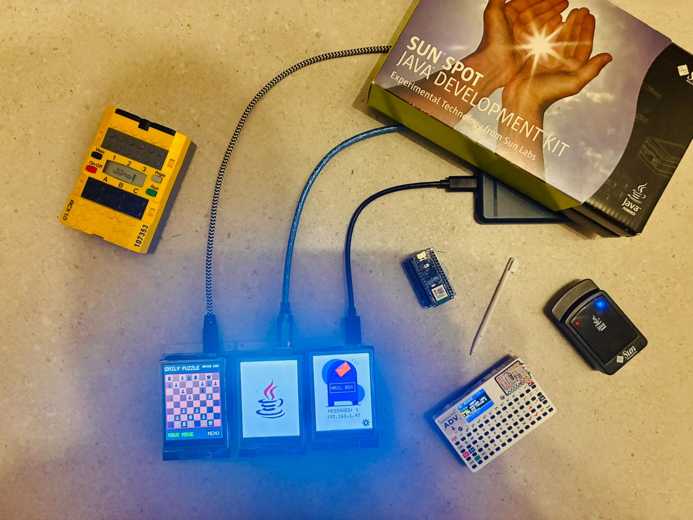

## Motivation

Traditionally, Java programs require a JVM to run. However, in memory-constrained environments, running Java programs inside a JVM can be difficult. Juno enables developers to create small Java programs for microcontrollers such as Arduino.

## Boards supported

### Arduino Nano Family

<table>
  <tr>
    <td align="center" width="50%">
      <strong>Arduino Nano ESP32</strong><br>
      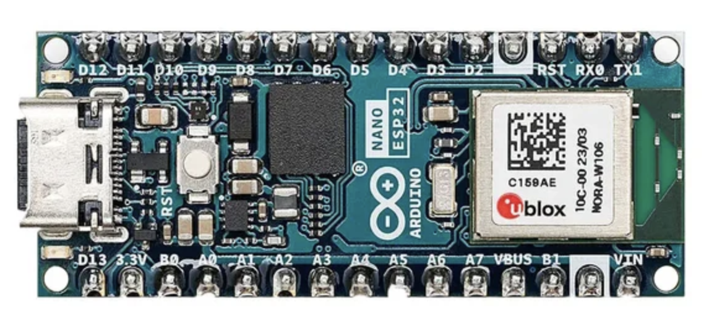
    </td>
    <td width="50%"></td>
  </tr>
</table>

## Arduino Nano shields supported

<table>
  <thead>
    <tr>
      <th>Accessory</th>
      <th>Image</th>
      <th>Supported features</th>
    </tr>
  </thead>
  <tbody>
  <tr>
    <td><strong>Arduino Nano Connector Carrier</strong></td>
    <td align="center">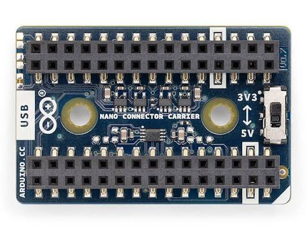</td>
    <td>Passive carrier for the Arduino Nano ESP32: microSD card slot on SPI, four Grove sockets, and one Qwiic connector.</td>
  </tr>
  </tbody>
</table>

## AI Thinker boards supported

<table>
  <tr>
    <td align="center" width="50%">
      <strong>AI Thinker ESP32-CAM</strong><br>
      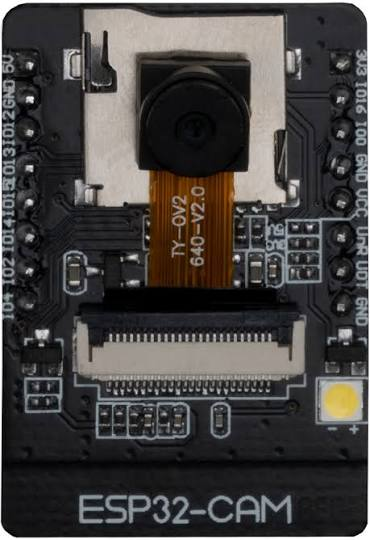
    </td>
    <td width="50%"></td>
  </tr>
</table>

## M5Stack boards supported

<table>
  <tr>
    <td align="center" width="50%">
      <strong>M5Stack Cardputer Adv</strong><br>
      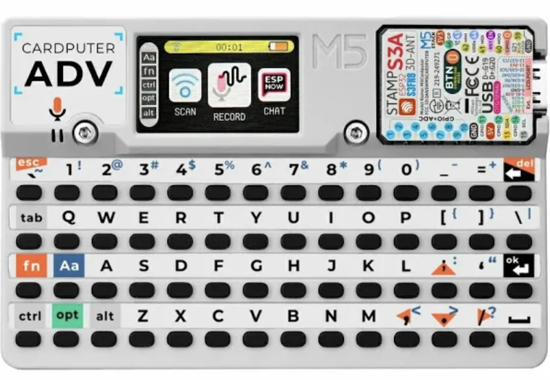
    </td>
    <td width="50%"></td>
  </tr>
</table>

## Raspberry Pi boards supported

<table>
  <tr>
    <td align="center" width="50%">
      <strong>Raspberry Pi Pico 2 W</strong><br>
      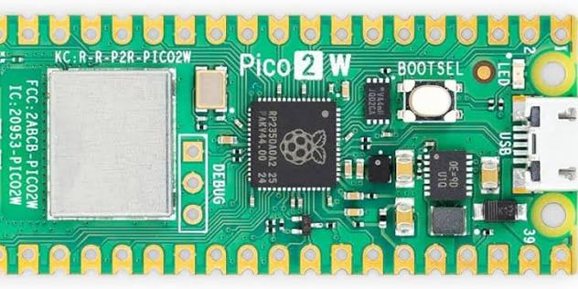
    </td>
    <td width="50%"></td>
  </tr>
</table>

## Raspberry Pi Pico shields supported

<table>
  <thead>
    <tr>
      <th>Shield</th>
      <th>Image</th>
      <th>Supported features</th>
    </tr>
  </thead>
  <tbody>
  <tr>
    <td><strong>Grove Shield for Pi Pico</strong></td>
    <td align="center">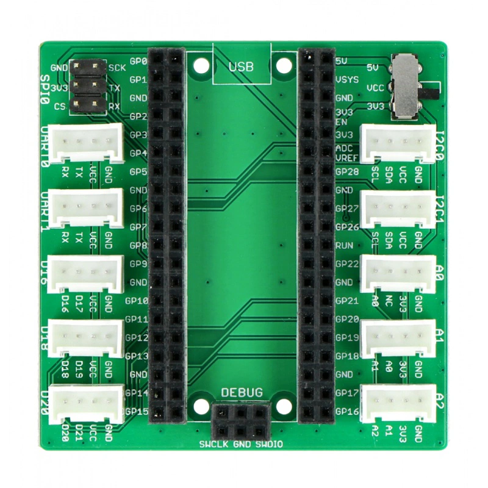</td>
    <td>Grove digital, analog, I2C, UART, and SPI connectors.</td>
  </tr>
  </tbody>
</table>

### Arduino Uno Family

<table>
  <tr>
    <td align="center" width="50%">
      <strong>Arduino UNO Q</strong><br>
      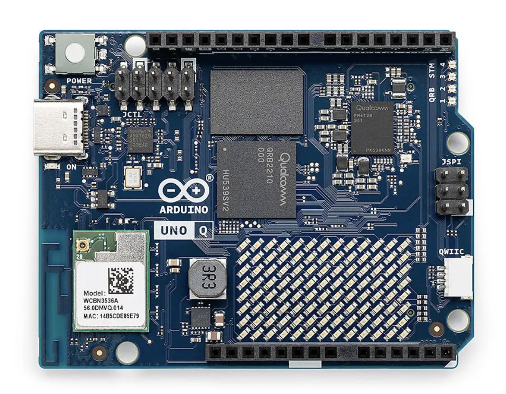
    </td>
    <td align="center" width="50%">
      <strong>Arduino UNO R4 WiFi</strong><br>
      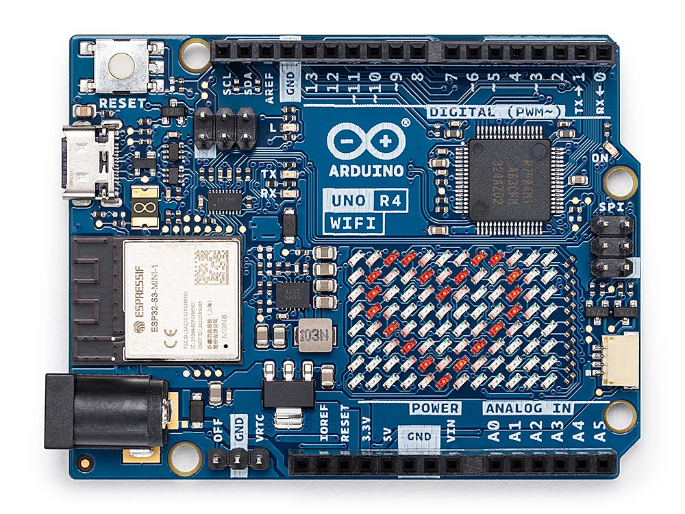
    </td>
  </tr>
  <tr>
    <td align="center" width="50%">
      <strong>Arduino UNO R3 WiFi Rev2</strong><br>
      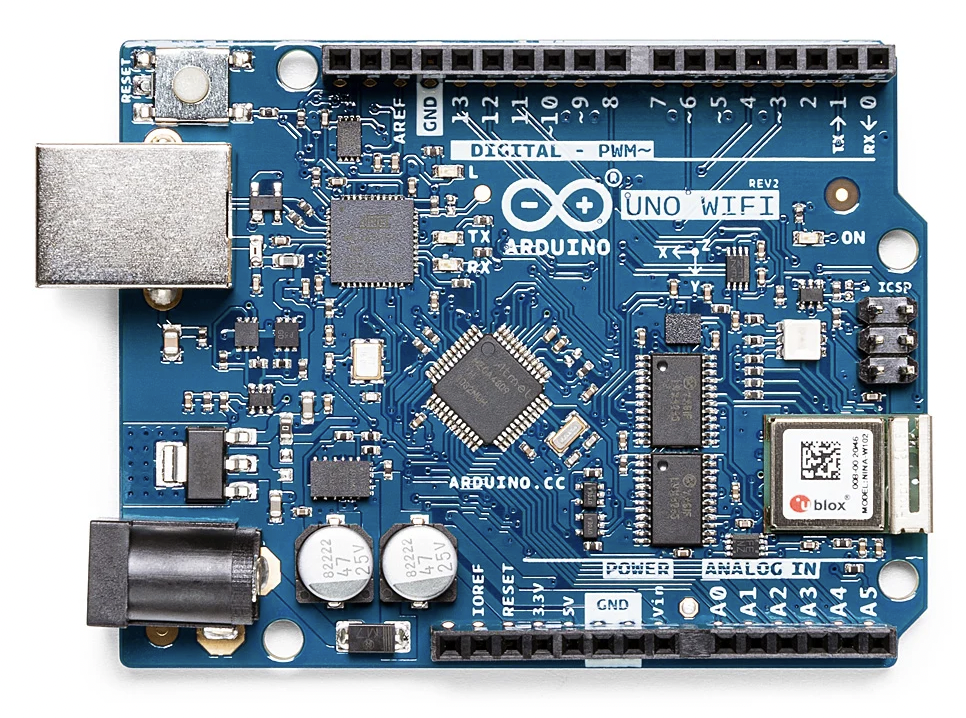
    </td>
    <td align="center" width="50%">
      <strong>Arduino UNO R3</strong><br>
      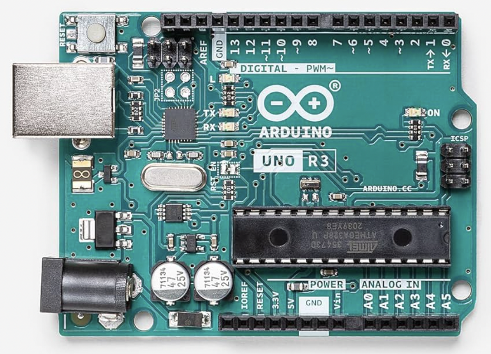
    </td>
  </tr>
</table>

## Arduino Uno shields supported

<table>
  <thead>
    <tr>
      <th>Shield</th>
      <th>Image</th>
      <th>Supported features</th>
    </tr>
  </thead>
  <tbody>
  <tr>
    <td><strong>LCD Keypad Shield</strong></td>
    <td align="center">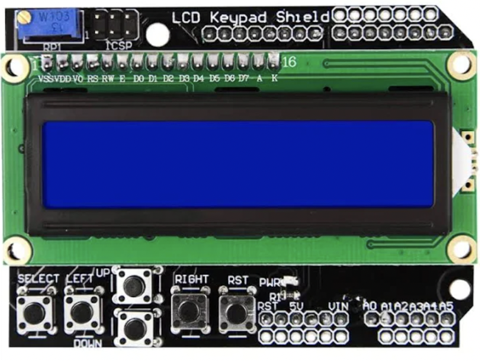</td>
    <td>16x2 HD44780 character display, five-button keypad, and controllable backlight.</td>
  </tr>
  <tr>
    <td><strong>ELEGOO 2.8-inch TFT Touch Shield</strong></td>
    <td align="center">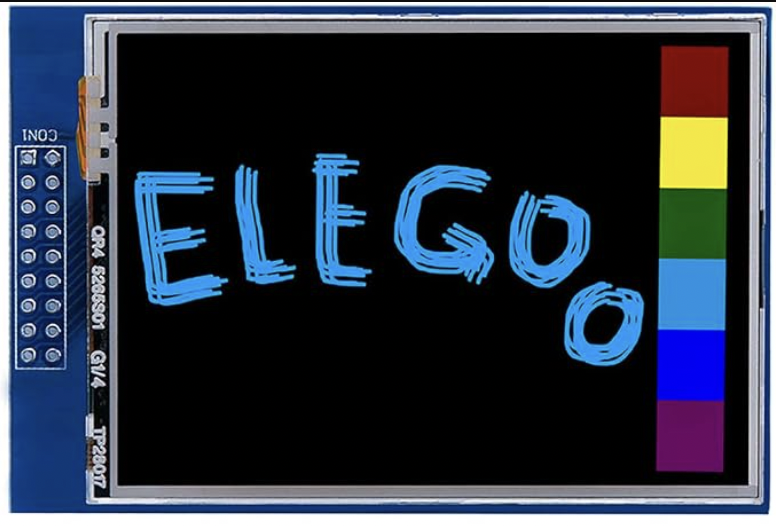</td>
    <td>240x320 ILI9341 display, resistive touch input, and an onboard microSD socket.</td>
  </tr>
  <tr>
    <td><strong>Arduino 9 Axis Motion Shield</strong></td>
    <td align="center">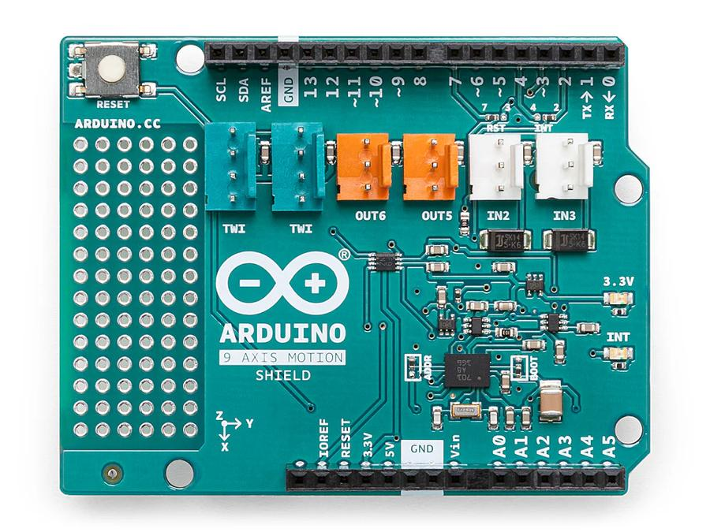</td>
    <td>BNO055 heading, pitch, roll, gyroscope, and calibration data over I2C.</td>
  </tr>
  <tr>
    <td><strong>PCA9685 PWM &amp; Servo Shield</strong></td>
    <td align="center">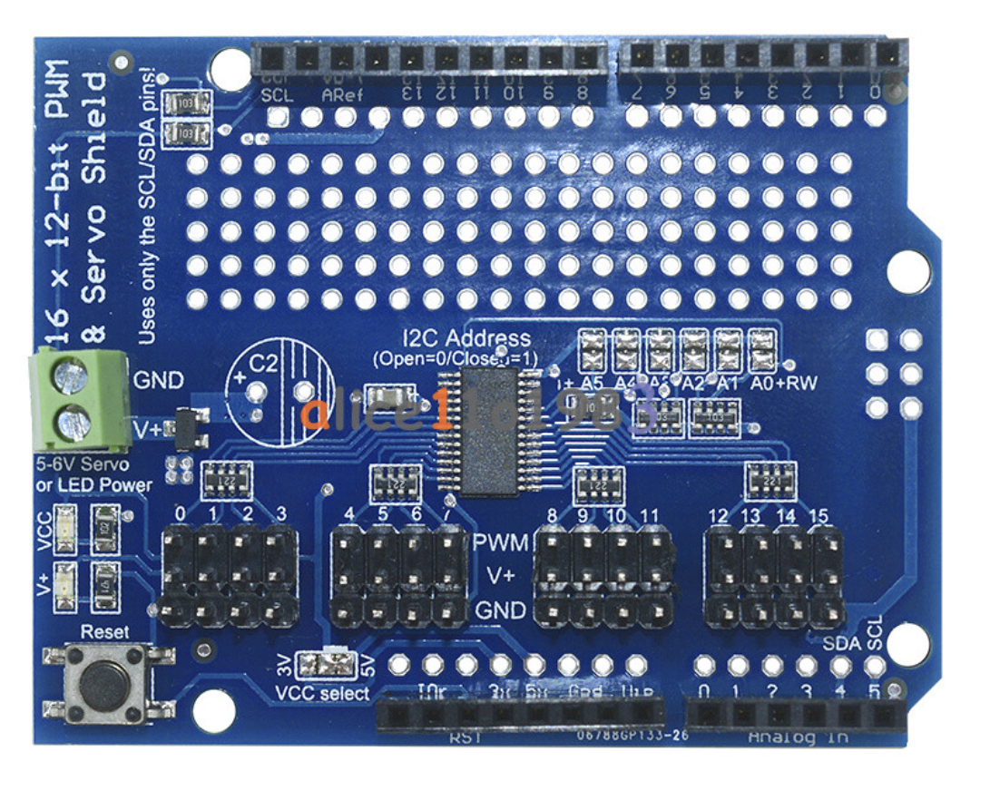</td>
    <td>Sixteen independently controlled 12-bit PWM/servo channels over I2C.</td>
  </tr>
  <tr>
    <td><strong>AZDelivery Data Logger Shield</strong></td>
    <td align="center">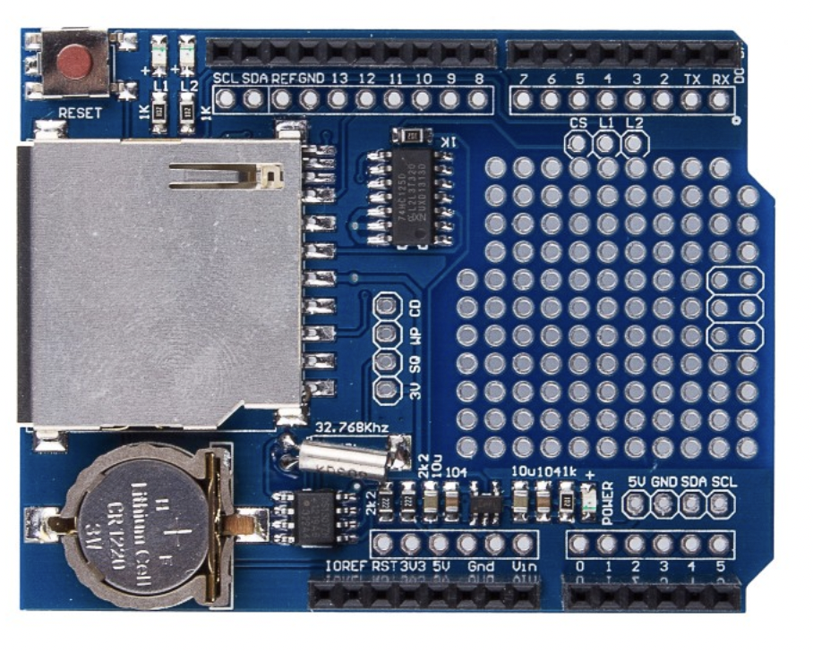</td>
    <td>SPI SD-card access. The shield's real-time clock is not currently exposed.</td>
  </tr>
  <tr>
    <td><strong>Grove Base Shield</strong></td>
    <td align="center">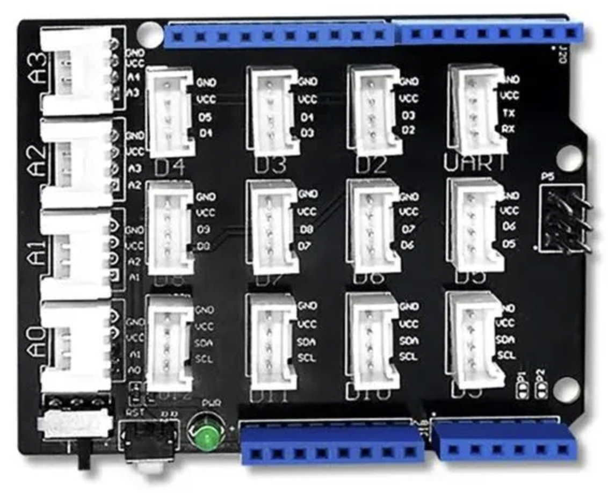</td>
    <td>Grove digital, analog, I2C, and UART connectors.</td>
  </tr>
  </tbody>
</table>

## Quick start

Requirements: `Arduino CLI`, `JDK 27+`, `Maven 3.10+`.

On macOS, install Arduino CLI with [Homebrew](https://brew.sh/) and verify that it is on your `PATH`:

```bash
brew update
brew install arduino-cli
arduino-cli version
```

See Arduino's [installation guide](https://docs.arduino.cc/arduino-cli/installation/) for direct downloads and other options.

```bash
sdk env install
./mvnw clean install
```

### Blink

[`Blink`](juno-examples/src/main/java/io/github/jabrena/juno/api/hardware/gpio/Blink.java) runs unmodified on every
supported board. Its built-in LED alternates on and off every 500 ms (one full cycle per second).

```java
package io.github.jabrena.juno.api.hardware.gpio;

import io.github.jabrena.juno.hardware.MCU;
import io.github.jabrena.juno.hardware.gpio.DigitalOutput;
import io.github.jabrena.juno.util.Delay;

public final class Blink {

    public static void main(String[] args) {

        DigitalOutput led = DigitalOutput.of(MCU.getGpio().getBuiltinLed());

        while (true) {
            led.high();
            Delay.millis(500);

            led.low();
            Delay.millis(500);
        }
    }
}
```

The project provides a `Maven plugin` to help the user with the common operations. `juno:flash` generates the sketch, verifies it with `arduino-cli`, and flashes it in one step.
`Blink` has no board restriction, so pick a target with `-Djuno.board`:

```bash
./mvnw -f juno-examples/pom.xml compile juno:flash \
  -Djuno.main=io.github.jabrena.juno.api.hardware.gpio.Blink \
  -Djuno.board=arduino-uno-q
# -Djuno.board=arduino-uno-r4-wifi
# -Djuno.board=arduino-uno-r3-wifi-rev2
# -Djuno.board=arduino-uno-r3
# -Djuno.board=arduino-nano-esp32
# -Djuno.board=ai-thinker-esp32-cam
# -Djuno.board=m5stack-cardputer
# -Djuno.board=raspberry-pi-pico-2-w
```

Select another supported board with `-Djuno.board`. The plugin auto-detects the port when exactly one matching board is
connected; otherwise, specify it with `-Djuno.port=<PORT>`.

After uploading the program, you could monitor what happen in the board using the following command:

```bash
./mvnw -f juno-examples/pom.xml juno:monitor \
  -Djuno.board=arduino-uno-q
```

## Maven plugin

The `juno` Maven plugin provides these goals. The commands below run them from the examples module;
add `-Djuno.main=<fully-qualified-class-name>` and `-Djuno.board=<id>` when the entry point has no single-board
`@Board` declaration.

<table>
  <thead>
    <tr>
      <th>Goal</th>
      <th>Purpose</th>
      <th>Command</th>
    </tr>
  </thead>
  <tbody>
    <tr>
      <td><code>juno:boards</code></td>
      <td>Lists the boards and serial ports detected by Arduino CLI without touching a board.</td>
      <td><code>./mvnw -f juno-examples/pom.xml juno:boards</code></td>
    </tr>
    <tr>
      <td><code>juno:install-deps</code></td>
      <td>Installs the Arduino core and optional libraries required by the examples.</td>
      <td><code>./mvnw -f juno-examples/pom.xml juno:install-deps</code></td>
    </tr>
    <tr>
      <td><code>juno:compile</code></td>
      <td>Generates the assembly, C++ runtime shim, and Arduino sketch wrapper.</td>
      <td><code>./mvnw -f juno-examples/pom.xml compile juno:compile -Djuno.main=io.github.jabrena.juno.api.hardware.gpio.Blink -Djuno.board=arduino-uno-r4-wifi</code></td>
    </tr>
    <tr>
      <td><code>juno:verify</code></td>
      <td>Generates the sketch and compiles it with Arduino CLI without using physical hardware.</td>
      <td><code>./mvnw -f juno-examples/pom.xml compile juno:verify -Djuno.main=io.github.jabrena.juno.api.hardware.gpio.Blink -Djuno.board=arduino-uno-r4-wifi</code></td>
    </tr>
    <tr>
      <td><code>juno:flash</code></td>
      <td>Generates, verifies, and uploads the sketch to the selected or detected board.</td>
      <td><code>./mvnw -f juno-examples/pom.xml compile juno:flash -Djuno.main=io.github.jabrena.juno.api.hardware.gpio.Blink -Djuno.board=arduino-uno-r4-wifi</code></td>
    </tr>
    <tr>
      <td><code>juno:monitor</code></td>
      <td>Opens the serial monitor for the selected or detected board.</td>
      <td><code>./mvnw -f juno-examples/pom.xml juno:monitor -Djuno.board=arduino-uno-r4-wifi</code></td>
    </tr>
  </tbody>
</table>

For example, verify the Grove Temperature and Humidity Sensor Pro monitor for a UNO WiFi Rev2
without uploading it:

```bash
./mvnw -f juno-examples/pom.xml compile juno:verify \
  -Djuno.main=io.github.jabrena.juno.api.hardware.device.grove.sensors.GroveDht22Monitor \
  -Djuno.board=arduino-uno-r3-wifi-rev2
```

## Supported Java subset

Juno is an ahead-of-time compiler, not a JVM. It links a program closed-world from `main`, validates every reachable
bytecode, and stops with a diagnostic (method, bytecode offset, unsupported operation) rather than emit code whose
behavior it cannot guarantee. Valid Java is therefore not automatically valid Juno input.

| Area | Supported |
|------|-----------|
| Language core | `main()` / `main(String[])`, static and instance methods, all eight primitive types, control flow and `switch`, fixed-size (also multidimensional) arrays, constant lookup tables kept in flash |
| Objects | classes, inheritance, interfaces, enums, records, lambdas and method references |
| Exceptions | `throw`, `try`/`catch`/`finally`, multi-catch, propagation between methods, try-with-resources |
| Library | `String` and `StringBuilder`, `Math`, `BigInteger`/`BigDecimal`, `LocalDateTime` (SNTP), `UUID`, random numbers |
| Concurrency | virtual threads and the JDK 27 preview `StructuredTaskScope` on one preemptive scheduler (up to four threads including `main`), monitors, `ReentrantLock`, atomics, `ScopedValue` |
| Board services | GPIO, serial, clocks, LED matrix, mouse, Wi-Fi, HTTP/HTTPS, UDP/TCP, SD card, and stacked shields (pin conflicts are rejected at compile time) |

## Maven modules

This is a multi-module Maven build:

- [`juno-api/`](juno-api) — the programming model: the Java-facing hardware API the compiler
  recognizes as intrinsics (`api/`) and the `@Board` annotations used to select a compilation
  target (`annotations/`). This is the only artifact programs compile against.
- [`juno-compiler/`](juno-compiler) — the compiler (`classfile`, `bytecode`, `linker`, `backend`, …),
  which depends on `juno-api`. Builds the executable `juno-compiler/target/juno-compiler-<version>.jar`.
- [`juno-maven-plugin/`](juno-maven-plugin) — Maven goals for generating a sketch (`juno:compile`),
  compiling it with Arduino CLI (`juno:verify`), uploading it (`juno:flash`), and opening the
  serial monitor (`juno:monitor`).
- [`juno-examples/`](juno-examples) — example Java programs written against `juno-api`, built
  like any other Maven module so they're checked for compile errors on every build.
- [`juno-site/`](juno-site) — the [Roq](https://iamroq.dev)/Quarkus static site generator behind
  the [documentation site](https://jabrena.github.io/juno/). `docs/` is entirely generated from
  Markdown under `juno-site/src/main/resources/content/` — see
  [Documentation site](#documentation-site) below to regenerate it.
- [`juno-third-parties/`](juno-third-parties) — integrations maintained outside the core compiler,
  currently including the independent H8/300 firmware generator for the LEGO RCX, its S-record,
  and the generated Java representation consumed by `juno-examples`.

## Architecture

Juno is an ahead-of-time compiler, not a virtual machine. An Arduino board has no JVM, so nothing is
interpreted at run time: the Java program is compiled with `javac` as usual, and Juno then translates the
resulting JVM bytecode into native ARM assembly that the Arduino toolchain builds into the sketch's firmware.
The compiler is *closed-world*: it only sees the classes reachable from `main`, so it can resolve every call
at build time, drop everything unused, and reject anything outside the supported subset before generating a
single instruction. That is also why there is no dynamic class loading, reflection, or general heap.

### From Java to a running board

```text
 Hello.java ──javac──▶ Hello.class ──▶ Juno ──▶ Hello.S + HelloShim.cpp + HelloAsm.ino ──arduino-cli──▶ board
                                       │
                 classfile → bytecode → linker → lowering → optimize → backend
```

1. **Write and compile Java.** Programs use the Juno hardware API and optionally select a board with `@Board`.
   Maven runs `javac`; Juno consumes the resulting `.class` files.
2. **Link and validate.** Juno starts at `main`, keeps only reachable code, converts hardware calls into
   intrinsics, and rejects unsupported bytecode with a precise diagnostic.
3. **Lower and optimize.** Reachable methods become Juno IR, where compiler passes simplify the program and
   report risks such as excessive arena use, recursion, or unsafe array access.
4. **Generate the sketch.** The backend emits native assembly and a small C++ runtime shim. The Maven plugin
   packages them with a minimal `.ino` under `target/juno/<Main>Asm/`.
5. **Build and run.** Arduino CLI compiles the generated sketch for the selected board. Use `juno:verify` to
   compile it, `juno:flash` to flash it, and `juno:monitor` to read its serial output.

## References

- https://dev.java/
- https://docs.oracle.com/javase/specs/jls/se25/html/index.html
- https://docs.oracle.com/en/java/javase/27/docs/api/index.html
- https://github.com/openjdk/jcstress/tree/master/jcstress-samples
- https://openjdk.org/
- https://openjdk.org/groups/conformance/JckAccess/
- https://github.com/openjdk
- https://docs.arduino.cc/hardware/uno-q/
- https://docs.arduino.cc/hardware/uno-r4-wifi/
- https://docs.arduino.cc/hardware/uno-wifi-rev2/
- https://docs.arduino.cc/hardware/uno-rev3/
- https://docs.arduino.cc/hardware/nano-esp32/
- https://docs.m5stack.com/en/core/Cardputer-Adv
- https://lejos.sourceforge.io/
- https://lejos.sourceforge.io/ev3/docs/index.html
- https://lejos.sourceforge.io/nxt/nxj/api/index.html
- https://lejos.sourceforge.io/rcx/api/index.html
- https://sourceforge.net/p/lejos/wiki/Sensor%20Framework/
- https://pbrick.info/index.html-p=74.html
- https://tinyvm.sourceforge.net/
- https://sunspotdev.org/
- https://sunspotdev.org/docs/index.html
- https://bearssl.org/
